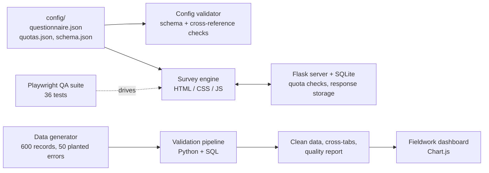
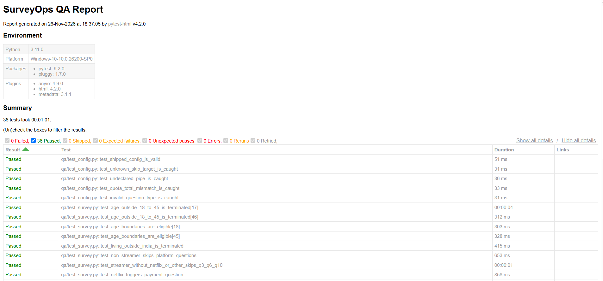
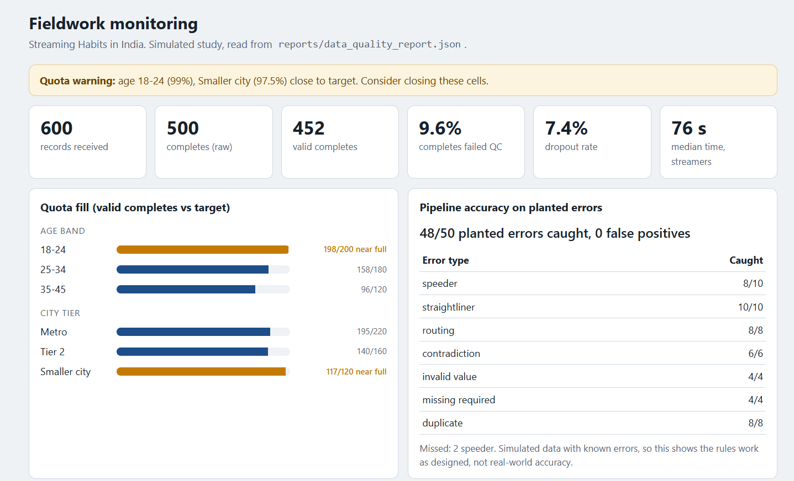

# SurveyOps: Configurable Survey Programming, Automated QA & Fieldwork Monitoring

A small end-to-end system that covers the lifecycle of a market research survey: **program it from a spec, test it, run fieldwork with quotas, clean the data and monitor progress.**

> **Disclaimer:** this is an independent simulation built for learning and portfolio purposes. It is not an implementation of Decipher/Forsta or any other vendor's platform, and all respondent data is synthetic.

## The scenario

A media research company wants to understand how Indian consumers discover and use streaming platforms. SurveyOps takes the questionnaire from a JSON specification to a working survey, checks that the survey behaves correctly, collects responses against age and city quotas, and delivers a validated dataset with cross-tabs.

## What is in it

| Part | What it does | Where |
|---|---|---|
| **Config-driven survey** | A 12-question survey rendered entirely from JSON. Edit the JSON and the survey changes, with no code edits | `config/`, `survey/` |
| **Server and database** | Flask + SQLite. Enforces quotas, stores responses, records abandoned surveys | `server/` |
| **Automated QA suite** | 36 tests. A real browser clicks through the survey and checks routing, validation, quotas and data capture | `qa/` |
| **Data pipeline** | Generates 600 simulated records with 50 planted errors, then validates, flags and cleans them using Python and SQL | `data/`, `pipeline/` |
| **Fieldwork dashboard** | Quota fill with near-full warnings, dropout, response flow, data quality and platform results | `dashboard/` |

## Architecture



## The survey

The questionnaire lives in `config/questionnaire.json`. The engine reads it and supports:

- Screener and eligibility questions that terminate ineligible respondents (age outside 18-45, living outside India)
- Skip logic and answer piping (`{{Q4}}` in a question inserts the platform the respondent chose)
- Single-select, multi-select, numeric, open text and matrix questions
- Randomised answer order, with "Other" and "None of these" anchored last, and exclusive options
- Age and city quotas, with a quota-full ending
- Per-question timings and recording of respondents who leave part-way

Conditions are structured data rather than code strings, which makes them easy to validate and test:

```json
{
  "id": "Q6",
  "type": "single_select",
  "text": "How do you mainly pay for Netflix?",
  "show_if": { "q": "Q2", "op": "contains", "value": "netflix" }
}
```

`config/schema.json` defines what a valid questionnaire looks like, and `qa/validate_config.py` adds cross-reference checks on top (skip rules that point at questions that do not exist, undeclared piping, quota targets that do not add up). A bad edit fails with a readable message instead of a broken survey.

## Automated QA

36 tests run against the real survey in a real Chromium browser, with the real server on a throwaway database.



| Area | What is checked |
|---|---|
| Screening and termination | Ages 17 and 46 are terminated, 18 and 45 are eligible, living outside India ends the survey |
| Routing and piping | Non-streamers skip platform questions, Netflix and Other trigger their follow-ups, "most used" options come only from the platforms selected, the chosen platform name appears in the next question |
| Validation | Empty, decimal and out-of-range age, unanswered single and multi-select, empty text, partly completed matrix |
| Option behaviour | "None of these" is exclusive, anchored options stay last, the same seed gives the same order |
| Data capture | Answers and timings recorded, response saved to the database, leaving part-way is logged as abandoned |
| Quotas | A full age or city group is blocked while others continue, warning at 90%, duplicate respondent rejected |
| Config-driven claim | Changing the age limit in the JSON from 45 to 50 lets a 48-year-old in |
| Config validator | Accepts the real config and catches four kinds of broken edit |

To see that the suite catches real problems, break something (for example, raise the upper age limit in `questionnaire.json` or change a `show_if` target) and rerun it. Tests fail as they should.

## Data pipeline

`data/generate_responses.py` builds 600 records by walking the questionnaire, so the data follows the survey's own routing: 500 completes, 60 screened out, 40 abandoned. It plants **50 known errors** in the completes and writes an answer key. `pipeline/validate.py` then checks every complete against the questionnaire rules, so changing the JSON changes the checks.

| Check | Catches |
|---|---|
| Routing violation | A question answered that should have been skipped |
| Missing required | A shown question left unanswered |
| Invalid option / out of range | An answer code or value that does not exist |
| Ineligible complete | A respondent who should have been screened out |
| Contradiction | A "most used" platform the respondent did not select |
| Straightlining | The same rating given to every row of the matrix |
| Speeder | Time under 40% of the median for the same route |
| Duplicate | Identical answers submitted within 15 minutes |

**Result on the simulated data: 48 of 50 planted errors caught, 0 genuine respondents flagged.**

Things worth knowing about that result:

- The two misses were speeders at 31 seconds against a 30-second cutoff. I left the threshold alone instead of tuning it to reach 50 out of 50.
- My first duplicate rule ("identical answers") wrongly flagged 4 genuine respondents. Short routes can produce identical answers by coincidence, so a duplicate now also requires the submissions to be close in time.
- The data is simulated with known error types, so this shows the rules work as designed. It is not a claim about accuracy on real survey data.

The pipeline writes a clean dataset, a flagged-records file with the reason for each flag, a SQLite database queried by `pipeline/analysis.sql` (nine named queries), an Excel workbook of cross-tabs and a short research summary.

## Fieldwork dashboard



The dashboard shows quota fill against target with a warning when a cell is near full, dropout rate and where respondents left, daily response flow, the records failing each quality check, platform use by age band, and the pipeline's accuracy against the planted errors.

## Run it

Requires Python 3.10+ and Node.js (Node is only needed for the quick logic test).

```bash
pip install -r requirements.txt
playwright install chromium

python server/app.py
# Survey:    http://localhost:8000/survey/
# Dashboard: http://localhost:8000/dashboard/
```

Other commands:

```bash
python qa/validate_config.py        # check the questionnaire and quota config
node qa/smoke_engine.js             # quick logic test of the engine, no browser
python -m pytest --html=reports/qa_report.html --self-contained-html   # full QA suite and report
python data/generate_responses.py   # regenerate the simulated data
python pipeline/validate.py         # validate, clean and build reports
python server/app.py --reset        # clear stored survey responses
```

Use `127.0.0.1` rather than `localhost` if another local server is already using port 8000.

## Project structure

```
surveyops-market-research/
├── config/       questionnaire.json, quotas.json, schema.json
├── survey/       index.html, engine.js, styles.css
├── server/       app.py (Flask + SQLite)
├── qa/           test_survey.py, test_config.py, conftest.py, validate_config.py, smoke_engine.js
├── data/         generate_responses.py, sample_responses.csv, planted_errors.csv,
│                 clean_responses.csv, flagged_responses.csv
├── pipeline/     survey_logic.py, validate.py, analysis.sql
├── dashboard/    index.html
├── reports/      qa_report, dashboard screenshot, crosstabs.xlsx, research_summary.md,
│                 data_quality_report.json
├── pytest.ini
└── requirements.txt
```

## Limitations

- Quota status is read when a respondent opens the survey, so two people finishing at the same moment can overfill a cell slightly.
- The dashboard reads the pipeline's report file, not the live database. Rerun the pipeline to refresh it.
- The speeder rule uses a fixed 40% of the median route time. A real study would tune this against its own timing data.
- Flask's development server and no authentication: this is a demo, not a production system.
- The data is synthetic and the survey is a simulation of a survey-programming workflow, not a copy of any commercial platform.

## Author

Built by Shahin Sayyed.
